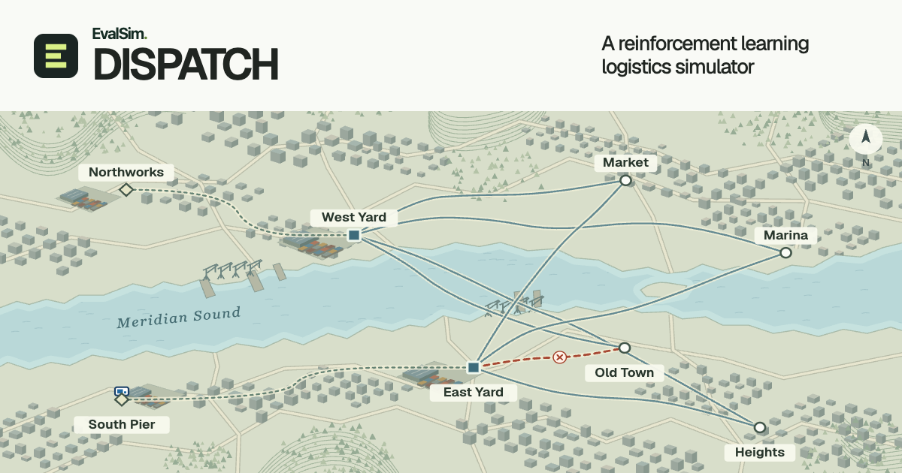

# EvalSim DISPATCH

[Try the uncertainty decision](https://arhaan2.github.io/evalsim-dispatch/uncertainty.html#replays) · [Benchmark your fleet agent](UNCERTAINTY.md) · [Browse DISPATCH studies](https://arhaan2.github.io/evalsim-dispatch/studies.html) · [Try the take-or-wait challenge](https://arhaan2.github.io/evalsim-site/#take-or-wait)

## Should the dispatcher trust this overnight override?

The preceding fleet agent proposes an empty-truck move. The trained dispatcher estimates how far its payoff might fall below forecast, then decides whether to keep the rolling planner's choice. Across **8,192 weeks from four unseen schedules**, it earned **334.13 net credits per week** and served **73.779%** of contracts on time, versus **333.69** and **73.744%** for the planner. The paired differences were +0.443 credits (95% interval −0.015 to +0.912) and +0.035 percentage points (−0.046 to +0.121). Both the fresh earnings advantage and the zero-shortfall service match remain unproven.

On **4,096 fresh double-return weeks**, the new policy kept a **+1.525-credit** advantage over the planner (+0.788 to +2.274) and served **0.227 percentage points more contracts** (+0.090 to +0.347). The unfiltered override agent earned 1.779 more credits than the planner on those weeks. On the four unseen schedules the new policy kept the planner's move on 380 of 1,626 recommendations. The downside penalty accounted for 266 of those decisions. Its earnings differences against removing the penalty (+0.041 credits) and using a constant penalty (+0.006) both included zero in their paired intervals. [Results and four paired decisions](https://arhaan2.github.io/evalsim-dispatch/uncertainty.html#results) · [Training report](training/uncertainty/)

## When should the fleet agent override the planner?

A signed load stays with the truck the rolling planner assigned. On four nights, RL estimates whether a different empty-truck placement will earn back its cost by Friday. On **2,048 new weeks from the original double-return schedule**, the release earned **2.32 more net credits per week** than the planner (paired 95% interval +1.13 to +3.52) and served **0.420 percentage points more contracts on time** (+0.205 to +0.630). The original unrestricted fleet RL earned 5.07 more credits than the planner on those same weeks.

Across **4,096 weeks on four unseen schedules**, the override policy earned 330.20 net credits per week and served 72.70% of contracts on time. The planner earned 329.77 and served 72.65%. The differences of +0.43 credits (−0.28 to +1.16) and +0.056 percentage points (−0.078 to +0.190) cleared neither preregistered fresh-week criterion. The release did earn 1.17 more credits per week than the preceding overnight policy (+0.43 to +1.90). It accepted 851 of 8,647 eligible challenges, earning 33.32 more credits per week than forcing every alternative. [Results and paired decisions](https://arhaan2.github.io/evalsim-dispatch/override.html#results) · [Training and reproduction](training/override/)

## When is an overnight empty move worth it?

On Monday through Thursday afternoons, a trained policy can move an idle truck or let it wait. The rolling planner assigns the freight. On **2,048 unseen weeks**, the agent averaged **338.09 net credits and 74.73% on-time service**, versus **338.36 and 74.63%** for the planner. The earnings difference was −0.27 credits per week (paired 95% interval −1.16 to +0.56). The service difference was +0.093 percentage points (−0.059 to +0.249). Both differences were inconclusive under the preregistered criteria.

Allowing overnight empty moves earned **16.51 more net credits** and served **4.61 percentage points more contracts** than the same agent forced to wait. On 1,024 new weeks using the original double-return schedule, the new policy’s +0.37-credit difference from the planner was inconclusive. The former fleet agent retained a +4.81-credit advantage on those same weeks. [Results and paired forks](https://arhaan2.github.io/evalsim-dispatch/overnight.html#results) · [Five fits and reproduction](training/overnight/)

## Where should two trucks finish today?

Two trucks move between three depots across five days. Each half-day offers one contract and two spot loads. A booking changes the starting point of the next round. The agent learned position values from 26,880 simulated training weeks across five independent fits. The release checkpoint was specified before training.

On 2,048 unseen weeks the RL agent averaged **339.73 net credits and 74.20% on-time service**. The rolling planner earned **342.40 and 74.84%**, and the greedy dispatcher earned **269.05 and 57.02%**. The RL-minus-planner difference was **−2.67 credits per week** (paired 95% interval −4.60 to −0.79). RL led by 4.89 credits on the double-return schedule. The overall earnings and service test favored the planner. [Results and paired replays](https://arhaan2.github.io/evalsim-dispatch/fleetweek.html#results) · [Five training fits and frozen protocol](training/fleetweek/)


## When does a survey make the dispatcher wait too long?

The final survey study trains a stopping rule for a specific disagreement. With a single truck slot, a public-history policy would book the signed offer, but the purchased survey makes its dispatcher want to wait. The new rule estimates the return from passing and can take the offer immediately.

On fresh cold-ending reversals, the release agent beat the fee-aware planner by **0.280 net credits per shift** (paired 95% interval +0.150 to +0.416). Across 50 paid surveys it booked exactly the same freight as always skipping and spent 3.75 credits in fees. It saved 40 credits relative to following the survey's original booking advice, all on one tape tested at two prices. A rule that stopped at every disagreement made the same saves.

On fresh hot drops the planner difference was **+0.0008 credits** (−0.0726 to +0.0750). Eight early bookings cost 80 credits relative to following the original advice. The hot-drop lead remained on the earlier market schedules with new seeds, and all eleven original interrupted-drop retention checks passed. [See the paired outcomes](https://arhaan2.github.io/evalsim-dispatch/waitcost.html#benchmark) · [Replay the stopping decisions](https://arhaan2.github.io/evalsim-dispatch/waitcost.html#slot-example) · [Training and independent audit](training/waitcost/)

## Does the survey change which load the dispatcher books?

The latest agent learns when to book or wait on each of the final offers with one truck slot left. On fresh cold reversals, its paid surveys changed the booked load 21 times. Six changes earned more freight credits and 15 earned fewer. On hot-ending drops, 64 of its 101 changes increased freight earnings.

Across six positive fees, the agent gained **0.204 net credits per hot drop** against the fee-aware planner (paired 95% interval +0.112 to +0.301). It trailed the planner by **0.052 per cold reversal** (−0.098 to −0.002). Neither target established a gain over the identical agent forced to skip. On the original interrupted drop it preserved the historical gains, earning 10.80 more credits than the legacy planner and 1.40 more than Booking. [Study results](https://arhaan2.github.io/evalsim-dispatch/loadchoice.html#benchmark) · [Replay changed loads](https://arhaan2.github.io/evalsim-dispatch/loadchoice.html#slot-example) · [Methods and independent audit](training/loadchoice/)

## When is a survey worth buying with one truck slot left?

On 16,384 fresh synthetic freight tapes, the specialist beat the fee-aware planner by **0.332 credits per hot-ending drop** and **0.129 per cold-ending reversal** across six positive survey prices. Buying information gained 0.018 credits per hot drop versus the same agent always skipping, with a paired 95% interval of −0.003 to +0.037. Its only two cold-reversal purchases cost 0.15 credits in total and added zero gross freight. It retained the original interrupted-drop gains. [Play the one-slot decision](https://arhaan2.github.io/evalsim-dispatch/lastslot.html) · [Benchmark a local agent](LASTSLOT.md) · [Results and methods](training/lastslot/)

## How much should a dispatcher pay for information?

Set the survey price before a shift. The agent can book freight earlier or keep a slot for a decision informed by a fresh reading. The planner gets the same price and opportunity. [Play the variable-price desk](https://arhaan2.github.io/evalsim-dispatch/tariff.html)

Across 4,096 new freight tapes at seven prices, the trained agent bought 264 times at positive prices. It earned +0.02 net credits per run against the Bayesian planner on fresh hot-ending drops (paired 95% interval −0.07 to +0.09) and +0.03 on fresh cold reversals (−0.10 to +0.17). Both comparisons were inconclusive. It retained the historical interrupted-drop gains, earning 11.22 more than the legacy planner and 1.17 more than Booking there. [Full results and purchase rates](training/tariff/) · [Run your own agent](TARIFF.md)

## Is a fresh demand survey worth buying?

Before wave six, both dispatchers can purchase a fresh six-sample reading. Play the choice with one truck slot open, then compare the fee with what the next load actually earned. [Play the desk](https://arhaan2.github.io/evalsim-dispatch/paid.html)

At one credit, both the trained agent and the survey-aware planner skipped all 8,192 fresh surveys. When the agent was forced to buy, it changed 185 booking sequences and lost 1.04 net credits per shift. Against the survey-aware planner it earned +0.02 on fresh hot-ending drops (paired 95% interval −0.02 to +0.06) and −0.21 on fresh cold-ending reversals (−0.33 to −0.09). It recovered the historical interrupted-drop gains and finished 0.01 behind the survey-aware planner there (−0.08 to +0.05). [Study results](training/paid/) · [Run your own agent](PAID.md)

## When should a dispatcher book before the final survey?

With two truck slots and eight offers, a dispatcher who waits can earn more on a later load or end the shift with capacity to spare. The new agent learns the value of both choices on the first six offers. On the last two it uses the previously released Survey policy. [Replay the booking decisions](https://arhaan2.github.io/evalsim-dispatch/booking.html#early-decisions)

On 8,192 fresh synthetic shifts it averaged **0.72 more net credits per shift than the distribution-aware planner**. It led by 0.26 on cold-ending reversals and trailed by 1.39 on hot-ending interrupted drops. On the original interrupted drop it gained 1.50 over Survey and remained 2.04 behind Rally. The earlier cold-reversal schedules also had a positive estimate, with an interval spanning zero. [Read the results](training/booking/) · [Benchmark your own agent](BOOKING.md)

## Can the dispatcher recognize a misleading survey?

At wave seven a noisy survey arrives with information about wave five. The new agent estimates when that reading points toward the wrong closing market, then weighs the signed offer against the value of keeping a truck slot. Play matched shifts with the same posted odds and see how newer freight prices affect the decision. [Play the public lab](https://arhaan2.github.io/evalsim-dispatch/survey.html#matched-survey)

On 8,192 fresh shifts the new agent reduced the gap between confidence and ending accuracy from 30.8 percentage points to 3.3. It beat the planner by **0.84 credits per cold-ending reversal** and trailed it by **1.04 per hot-ending drop**. On the original interrupted drop the agent beat the planner by 8.88 credits and lost 2.95 against Rally, missing the one-credit retention target. A control using signed offers alone had comparable ending forecast error. [Read the results and controls](training/survey/)

Run your own Python or JavaScript policy on the same fresh, original and archived markets with the survey suite. [Benchmark guide](SURVEY.md)

## Is this rally a lasting demand turn?

Two dispatchers see the same early rally and have room to book only two loads. One shift ends hot and the other cools. The learned demand model updates its estimate after every signed offer and survey, then prices its remaining truck slots. The desk shows its probability of a hot finish, the value of booking now, and the distribution-aware planner’s decision. [Play both endings](https://arhaan2.github.io/evalsim-dispatch/rally.html)

On 8,192 fresh shifts the learned agent earned 0.64 more net credits per shift than the planner overall. It **trailed by 0.54 credits on cold-ending reversals and 1.87 on hot-ending drops**. On the original interrupted drop it beat the planner by 11.79 and retained the gains of all three earlier policies. At wave seven the model predicted the correct ending 52.1% of the time. A separately trained agent using the current offer and bulletin reached 61.7%. [Paired results and forecast accuracy](training/rally/)

```sh
node tools/reserve.mjs --suite rally --policy ./examples/reserve-agent.mjs --out rally.json
node tools/reserve.mjs --verify rally.json
```

Score your own agent on the fresh shifts, the original drop and the eight earlier Trust patterns. Upload the report to the public desk to replay its decisions locally. [Agent guide](RALLY.md)

## When should the dispatcher trust history?

The planner and the trained dispatchers sometimes disagree about booking a load. The new agent learns the value of booking versus passing at those decisions. Visitors can see the advice behind a booking and replay a matched shift. The study also trains a two-expert agent restricted to the planner and the Closes history policy.

The three-expert agent recovered the original interrupted-drop gains within the one-credit tolerance. It earned **2.54 more credits per shift than Closes** and **11.61 more than the distribution-aware planner** there. On fresh hot-ending drops, it gained 0.83 over Closes and trailed the planner by 0.66 (95% paired interval −1.16 to −0.15). The earlier reversal patterns kept a 0.69-credit lead over the planner on new seeds. On previously unseen reversal patterns the difference was −0.02 (−0.23 to +0.19). The two-expert agent met the hot-drop tolerance on fresh patterns and missed the original-drop recovery. [Read the paired results and inspect actual routing decisions](https://arhaan2.github.io/evalsim-dispatch/trust.html#benchmark)

```sh
node tools/reserve.mjs --suite trust --policy ./examples/reserve-agent.mjs --out trust.json
node tools/reserve.mjs --verify trust.json
```

Score your own agent on 8,192 fresh shifts, the original interrupted-drop test, or the eight earlier Closes markets on new seeds. [Agent guide](TRUST.md) · [Training results](training/trust/)

## Does history help when the market can finish hot or cold?

Two shifts open with the same freight offers. Demand then diverges, and your two truck slots can be worth very different amounts at closing. This benchmark crosses every new market opening with both endings. The released history agent and its no-history counterpart trained on identical freight tapes. Each competes against the distribution-aware planner on 2,048 fresh reversals and 2,048 fresh interrupted drops.

On fresh reversals the history agent earned **49.72 credits per shift**, the no-history agent **49.61** and the planner **49.11**. History added 0.70 credits on cold endings and cost 0.47 on hot endings. Across both endings its contribution was +0.11, with a paired 95% interval of −0.01 to +0.25. The history agent kept a 4.23-credit lead over the planner on fresh interrupted drops overall. Hot-ending drops favored the planner by 4.50. On the original interrupted-drop pattern it lost 2.46 credits against the earlier Turns agent, missing the retention target. [Results and paired intervals](training/closes/)

```sh
node tools/reserve.mjs --suite closes --policy ./examples/reserve-agent.mjs --out closes.json
node tools/reserve.mjs --verify closes.json
```

Try both endings in the browser, or score a JavaScript or Python agent on the full test and the three historical interrupted-drop patterns. [Agent guide](CLOSES.md) · [Study results](training/closes/)

## Can an agent recognize a turn in demand?

On 1,024 fresh shifts with early or late turns, the Turns policy earned **48.88 net credits per shift**, ahead of the previous Drift policy at **47.88** and the distribution-aware planner at **44.48**. On reversals alone it recovered 2.49 credits against Drift and trailed the planner by 0.69. It kept the original interrupted-drop advantage. On fresh rebounds its lead over the planner was 9.47 credits, but the measured range against Drift narrowly missed the study’s retention target.

Removing the agent’s history features and refitting it on the same freight offers increased average earnings by 0.54 credits. History helped on fresh rebounds. All four test markets cooled before closing, so the benchmark also rewards learning the shift clock. [Paired results and training method](training/turns/)

```sh
node tools/reserve.mjs --suite turns --policy ./examples/reserve-agent.mjs --out turns.json
node tools/reserve.mjs --verify turns.json
```

Use the same four test markets for your own JavaScript or Python agent, or replay the new policy on the original 768 Demand Shift cases. [Agent guide and pinned release](TURNS.md)

## When the demand forecast is wrong

The Demand Shift benchmark gives dispatchers a delayed market bulletin and the history of signed freight offers. Its original Q-learning policy trained on one-way steps and ramps. The test reserves three whole patterns that change direction during a shift.

On 768 synthetic test shifts, the learned policy earned **46.49 net credits per shift** and the original distribution-aware planner earned **46.22**. The paired difference was **+0.27** (95% interval −0.43 to +0.95). The pattern mattered: the learned policy lost 12.10 credits per reversal shift and gained 11.46 on interrupted drops. The original Reserve Q checkpoint, applied directly, earned 26.77. [Read the measured results](training/drift/)

```sh
node tools/reserve.mjs --suite drift --policy ./examples/reserve-agent.mjs --out drift.json
```

Replay a matched shift in the browser, verify a Python or JavaScript agent’s score locally, or inspect every case in the release. [Demand Shift agent guide](DRIFT.md)

## Should you save a truck for a better offer?

Eight freight offers arrive one at a time. Two loads can ship. Play a shift, then compare your bookings with a trained Q-learning policy and two dispatch planners on exactly the same offers.

On the 768-shift public test suite, the released policy earned **33.70 net credits per shift**. A planner that books against average future offers earned **30.21**. A planner that uses the full probability distribution earned **33.71**. RL’s largest gain over average-forecast planning was on surge shifts. All three policies tied on steady shifts. These are synthetic freight credits. [Results by demand pattern and training seed](training/reserve/)

```sh
node tools/reserve.mjs --policy ./examples/reserve-agent.mjs --out my-result.json
```

This scores your agent on the published shifts, re-runs all three reference policies and saves every decision. Open the result in the browser lab or verify it locally. JavaScript modules and external programs, including Python, use the same observations. [Agent interface and benchmark guide](RESERVE.md)

## Can your agent decide when to buy information?

One express truck leaves soon. Two customers need a delivery. Checking inventory costs a credit and a tick. Play a shift yourself, switch which yard has stock and see whether the same strategy works. Try the public planner and trained policies against the same shift, or plug in a local JavaScript agent.

```sh
node tools/lab.mjs --policy ./examples/earliest-deadline.mjs --seed 42 --pairs 16
```

The command runs a 64-shift comparison from this checkout using Node.js 22+. The original code is [MIT licensed](LICENSE) for commercial reuse. The [lab guide](LAB.md) covers the observation and action API, trace verification, self-hosting, third-party notices and a public channel to suggest a workflow for evaluation. The [CPU experiment](training/cutoff/) and [matched Qwen experiment](training/cutoff/qwen/) include their protocols, results and reproduction instructions.

On 192 held-out shifts the trained CPU policies and the observation-only planner delivered both orders in every case. Disabling the planner's inventory check reduced success to 144/192. Both curricula needed a median of 768 calls to sustain the validation target. On a common 96-case subset, frozen Qwen solved 22 shifts. Imitation solved 48, 47 and 48 across three training runs. Adding on-policy RL yielded 48 in each run. None of the Qwen checkpoints solved both halves of an uncertain pair. These measurements concern a two-order synthetic network. [Discuss a workflow with EvalSim](https://arhaan2.github.io/evalsim-site/#contact)

## Meridian Harbor

[](https://arhaan2.github.io/evalsim-dispatch/)

Close a freight lane or double a customer order. Run two dispatch policies in the same fictional harbor, pause at the decision where their plans diverge, and follow the goods to their destination. The verifier credits an order when the cargo arrives on time.

The interactive policies run directly in your browser. The exhibit also includes a separate experiment with a local 4B language model. The two experiments have different policies, training budgets and test suites.

## What the browser policy learned

We trained a 34-feature linear action policy with REINFORCE in a partially observed logistics simulation. Each of three training seeds gets 2,304 episodes under an adaptive sampler and 2,304 under a uniform sampler. The comparison uses fixed final checkpoints. Both samplers run on one CPU core per process. Every operator faces the same 168 held-out scenarios.

| Operator | All orders on time, 168 cases | All orders on time, 48 unfamiliar combinations | Mean on-time unit fraction, 168 cases |
| --- | ---: | ---: | ---: |
| Before training | 7.1% | 6.3% | 78.2% |
| Hand-coded dispatcher | 74.4% | **83.3%** | 96.7% |
| Uniform RL | **82.5%** | 61.8% | **98.1%** |
| Adaptive RL | 78.4% | 50.0% | 97.4% |
| Harbor planner, created after evaluating v1 | **100%** | **100%** | **100%** |

“All orders on time” requires every committed unit to reach the correct destination by its deadline and all resource checks to pass. The two trained rows average three runs over the same 168 scenarios. The unfamiliar cases combine closure with demand surge, or change supplier connections while delaying inbound freight and cutting carrier capacity. The later planner used public observations and knowledge of the v1 scenario structure. It also completed 700/700 additional shifts drawn from that generator. [Planner method](training/harbor-planner/) · [Frozen v1](https://github.com/Arhaan2/evalsim-dispatch/tree/harbor-v1.0.0)

The adaptive sampler uses recent operator failures to change how frequently each scenario family appears. Both mean validation curves first crossed the prespecified 85% all-orders threshold at 1,728 episodes. Adaptive practice crossed earlier in two individual seed pairs and tied the third. This experiment establishes learning in this world. A general training-speed advantage remains an open question. [Technical report](training/RESULTS.md) · [Protocol and reproduction](training/README.md) · [Every held-out outcome](docs/data/test-outcomes.json)

## A second agent selects the challenge

We also trained a scenario-selection policy to choose feasible disruptions and opening demand levels that exposed weaknesses in its operator. Each of six runs had a budget of exactly 32,768 operator calls. The learned challenger's operators achieved 75.2% complete success on a fresh test suite, compared with 77.4% under matched uniform sampling. Visitors can sample a scenario from the saved challenger. [Protocol, results and reproduction](training/challenger/README.md)

## What changed for a 4B language model

We trained two rank-four action-selection adapters on Qwen3-4B. Each received 72 complete episodes with a different practice schedule. Twenty new test scenarios were shared across all four operators.

| Operator | Complete shifts | Units delivered on time |
| --- | ---: | ---: |
| Frozen Qwen3-4B | 0 / 20 | 467 / 657 |
| Qwen, balanced practice | 2 / 20 | 542 / 657 |
| Qwen, adaptive practice | 1 / 20 | 509 / 657 |
| Dispatcher | 16 / 20 | 647 / 657 |

The balanced arm used 1,018 training tool calls and the adaptive arm used 951. Neither reached the prespecified 85% validation threshold. These are paired pilot measurements from one training seed. See the choices and rejected bookings in the [recorded comparison](https://arhaan2.github.io/evalsim-dispatch/language-model.html). [Balanced results](docs/data/llm/results.json) · [Adaptive results](docs/data/llm-curriculum/results.json) · [Model, method and local inference](training/language-model/README.md)

**Can the simulator teach an individual decision?** In a separate 60-episode experiment, we scored the consequences of 5,964 possible actions by asking what would happen if the dispatcher finished each alternative shift. Those training branches took another 70,100 simulated tool calls. On 21 previously unused test shifts, the new adapter completed 4, frozen Qwen completed 2, and the dispatcher completed 17. The adapter delivered 555 of 665 units on time, up from 468. Four shifts changed from failure to success, and two changed from success to failure. The test suite and method differ from the 20-case pilot above. [Decision-level results and paired cases](https://arhaan2.github.io/evalsim-dispatch/language-model.html#decision-credit) · [Training method](training/language-model/decision-credit/README.md)

## Inside the harbor

- Two suppliers, two warehouses and four customer destinations share limited inventory, transport capacity, shipping budget and time. Stock and capacity reports can go stale.
- The simulator exposes typed calls to inspect orders and stock, check suppliers and transport, reserve or release goods, purchase inventory, book a shipment, track freight, and advance the clock. The learning operator uses a finite observation-derived menu of those calls. Manual logistics features encode knowledge about quantities, deadlines and costs.
- Seeded external events follow the simulation clock. Every fourth tool call advances it, and the operator can also explicitly wait. The viewer can compare policies at the same decision index and inspect the tick reached by each one.
- The independent ledger verifier reconciles shipments, inventories, capacity, deadlines and spending. A separate full-information witness checks that every validation and final test case admits a feasible plan. Operators never see that plan.

[World, tools and verifier](docs/lib/world.js) · [Browser policy](docs/lib/policy.js) · [Small policy checkpoints](docs/data/checkpoints.json)

## Run and verify

Node.js 22 or later runs the simulator tests, benchmark and local preview with no npm dependencies or account. Open the local address printed by the preview.

```sh
npm test
npm run audit:results
npm run audit:models
npm run audit:labs
npm start
```

The first result audit replays 1,344 policy/scenario pairs and checks a feasible solution for each of 228 validation or final cases. The second audits the learned challenger and its 1,176 held-out outcomes. Both compare measured outcomes to public artifacts. See the [Qwen training and inference instructions](training/language-model/README.md) to reproduce the language-model track.

## Link from EvalSim

GitHub Pages serves the contents of `docs/` on `main`. Link directly to the stable project URL, or use an episode link to preselect the seed and both operators.

```html
<a href="https://arhaan2.github.io/evalsim-dispatch/">Try EvalSim DISPATCH</a>
```

[Example link to a route closure, seed 42](https://arhaan2.github.io/evalsim-dispatch/?scenario=route-closure&seed=42&operator=trained&compare=untrained)
